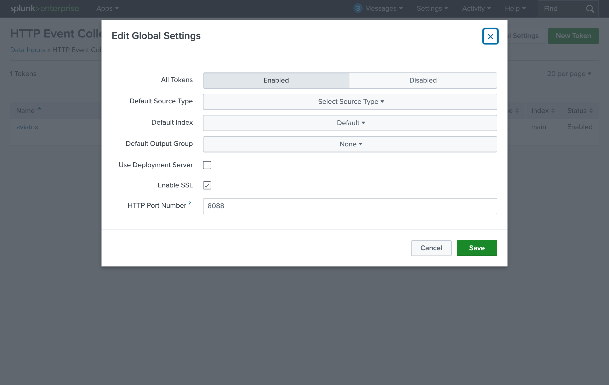
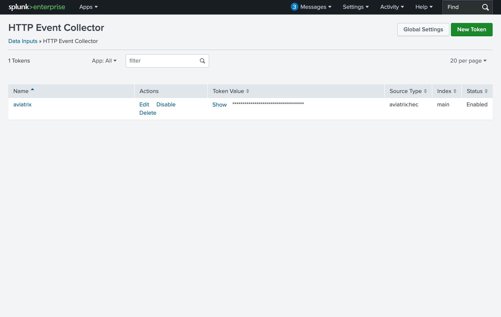
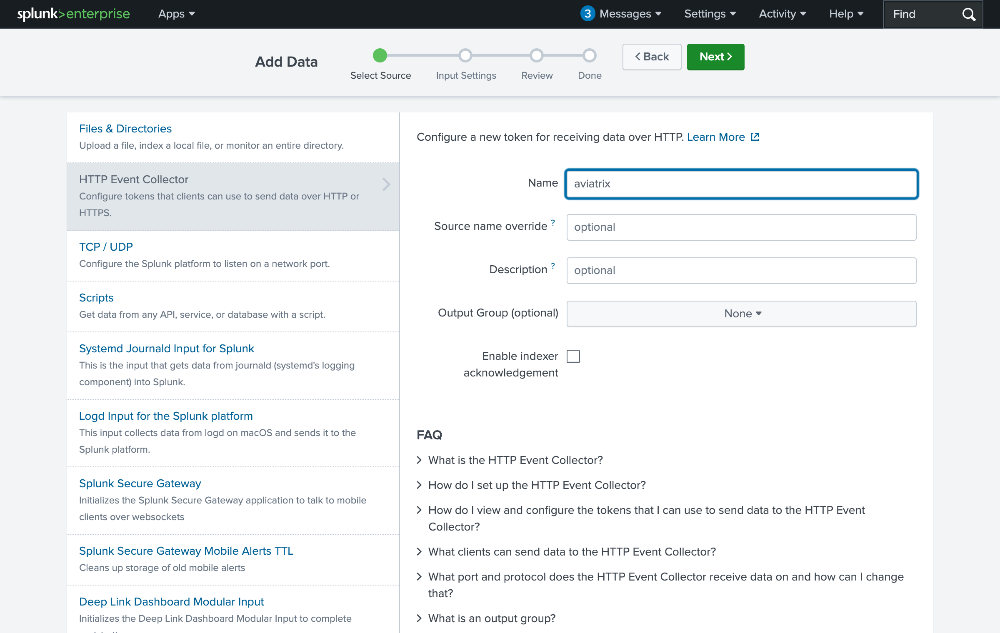
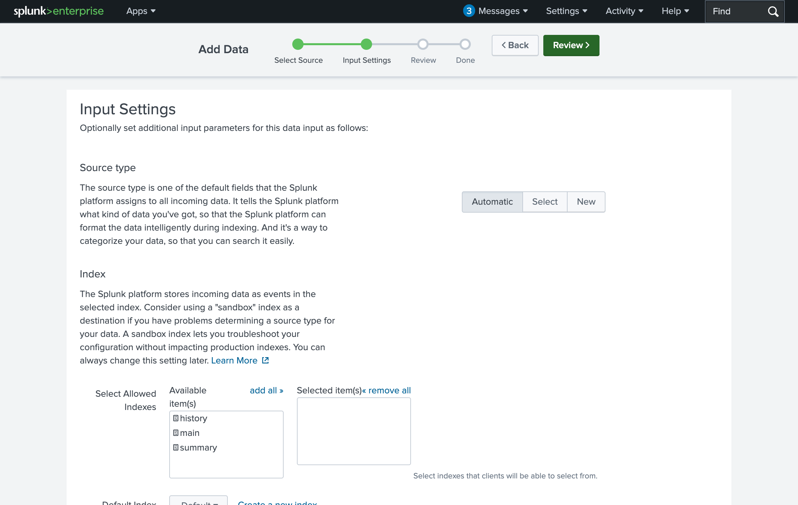
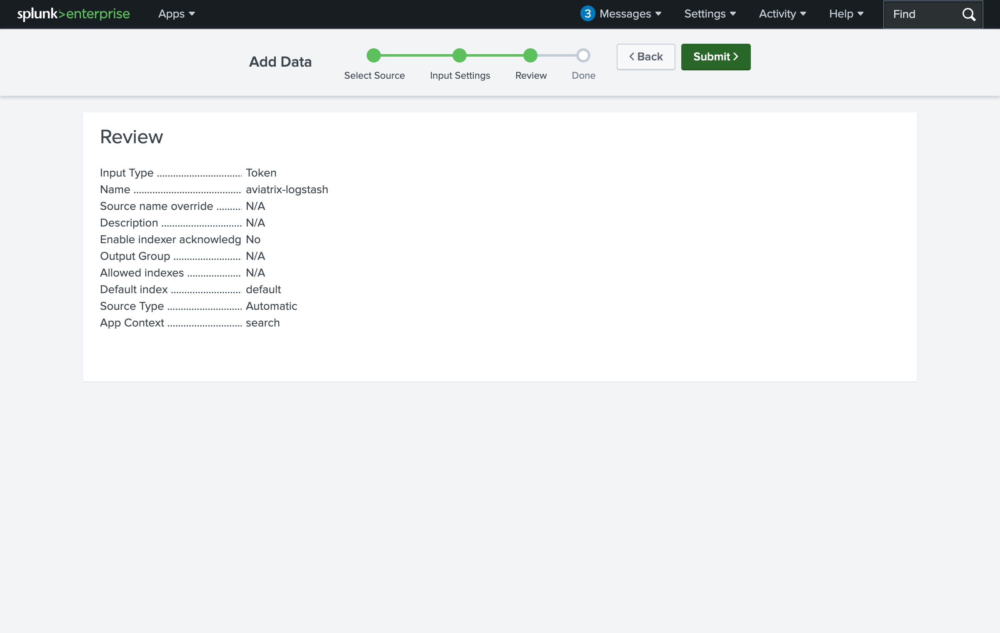
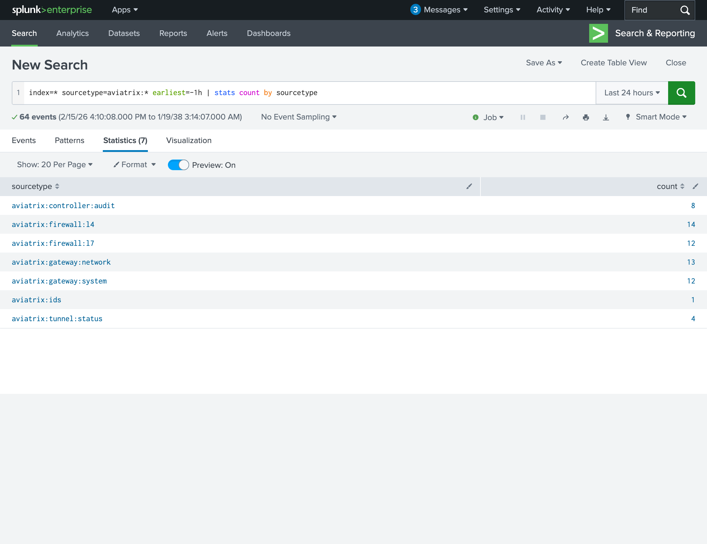
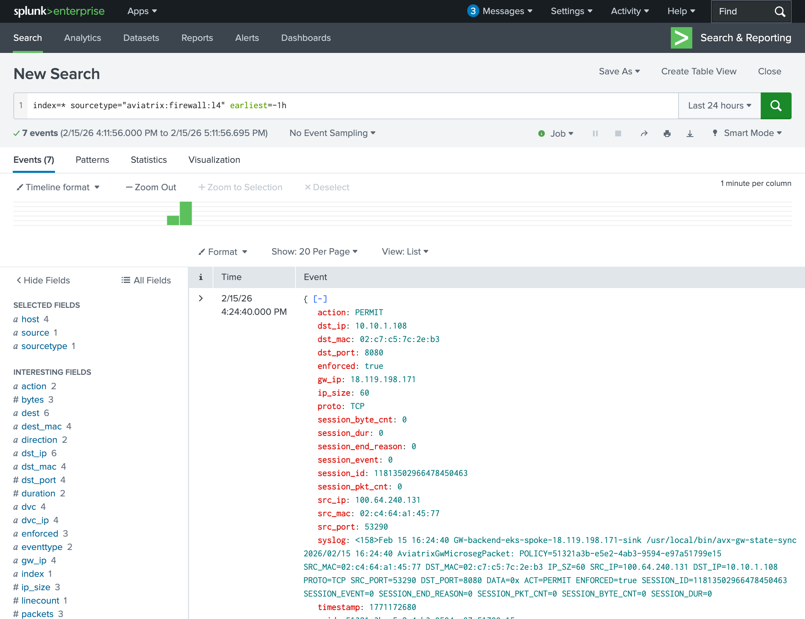
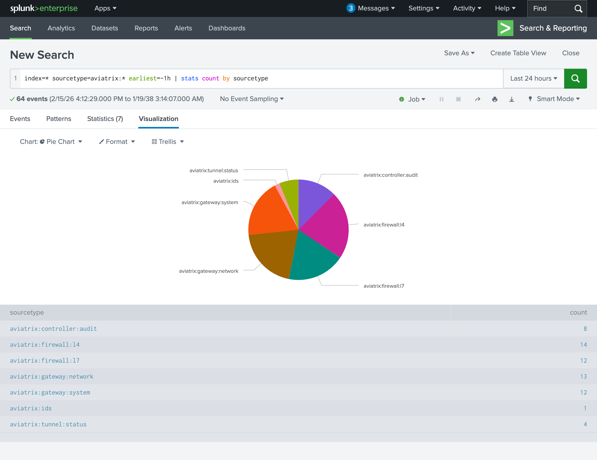

# AWS EC2 Single Instance Deployment

Deploy the Aviatrix SIEM Connector on a single EC2 instance. Logstash receives syslog from Aviatrix gateways and forwards parsed, structured events to the output selected by `output_type` (Splunk HEC in the examples below; also `dynatrace*`, `zabbix`, `azure-log-ingestion`).

## Architecture

```
Aviatrix Gateways ──► EC2 (Logstash Docker) ──► Splunk HEC
                      syslog :5000/tcp           :8088/https
```

- **EC2 instance** (t3.small) running Logstash 8.16.2 in Docker
- **S3 bucket** stores the Logstash config and grok patterns
- **Elastic IP** provides a stable syslog endpoint
- **Secrets Manager** holds the rendered `docker run` command (with credentials) in `avxlog-<suffix>-runtime`; the instance fetches it at boot, so credentials are not in user_data
- Instance is replaced when the config, patterns or credentials change (brief syslog outage during replacement). New AMIs do not replace it (`ignore_changes = [ami]`)

## Prerequisites

1. **Terraform** >= 1.0 and **AWS CLI** configured with appropriate credentials
2. **Optional SSH Key Pair** in the target AWS region. SSH is closed by default; the instance role has `AmazonSSMManagedInstanceCore`, so use SSM Session Manager or set `ssh_allowed_cidrs`
3. **VPC and Subnet** with network connectivity to your Splunk server
4. **Splunk HEC Token** -- see [Setting Up Splunk HEC](#setting-up-splunk-hec) below

## Setting Up Splunk HEC

The SIEM Connector sends parsed events to Splunk via the HTTP Event Collector (HEC). If you don't already have HEC enabled with a token, follow these steps.

### 1. Enable HEC and Verify Global Settings

Navigate to **Settings > Data Inputs > HTTP Event Collector**. Click **Global Settings** and ensure:
- **All Tokens**: Enabled
- **Enable SSL**: Checked
- **HTTP Port Number**: 8088



### 2. Create a New Token

From the HEC token list, click **New Token**.



**Step 1 -- Select Source:** Enter a name (e.g., `aviatrix`) and click **Next**.



**Step 2 -- Input Settings:** Leave Source Type as **Automatic** (Logstash sets the sourcetype per log type). Leave the default index. Click **Review**.



**Step 3 -- Review:** Confirm settings and click **Submit**.



**Step 4 -- Done:** Copy the **Token Value** -- you'll need it for `splunk_hec_auth` in the Terraform variables.

## Quick Start

### 1. Assemble the Logstash Config

```bash
cd logstash-configs
./scripts/assemble-config.sh splunk-hec
```

This creates `assembled/splunk-hec-full.conf`. Terraform reads it and `logstash-configs/outputs/<output_type>/docker_run.tftpl`, selected by `output_type`.

### 2. Configure Terraform Variables

```bash
cd deployments/aws-ec2-single-instance
cp terraform.tfvars.example terraform.tfvars
```

Edit `terraform.tfvars` with your values. At minimum, update these:

```hcl
# Network - MUST be in the same VPC as Splunk (or have routing to reach it)
vpc_id    = "vpc-xxxxx"
subnet_id = "subnet-xxxxx"

# Restrict syslog to your gateway/controller egress IPs (default 0.0.0.0/0)
allowed_syslog_cidrs = ["203.0.113.10/32"]

# Splunk HEC credentials (splunk_address must include https://)
output_type = "splunk-hec"
logstash_config_variables = {
  "splunk_hec_auth" = "your-hec-token-here"
  "splunk_address"  = "https://10.x.x.x"   # Private IP of Splunk
  "splunk_port"     = "8088"
}
```

> **Tip:** Use the **private IP** of your Splunk server if it's in the same VPC. Test connectivity first:
> ```bash
> curl -k -H "Authorization: Splunk <token>" \
>   https://<splunk-ip>:8088/services/collector/event \
>   -d '{"event":"test"}'
> ```
> A `{"text":"Success","code":0}` response confirms HEC is reachable and the token is valid.

For Dynatrace, Zabbix and Azure keys see `terraform.tfvars.example`. `zabbix` and `azure-log-ingestion` require `logstash_image` in `logstash_config_variables` (an image FROM stock Logstash with the plugin, e.g. built from `logstash-configs/outputs/zabbix/Containerfile`; not the GHCR connector image, whose entrypoint adds a second pipeline). Dynatrace uses `dt_environment_id` + `dt_api_token` and targets `https://<env>.apps.dynatrace.com/platform/classic/...`; see [docs/DYNATRACE_SETUP.md](../../docs/DYNATRACE_SETUP.md).

### 3. Deploy

```bash
terraform init
terraform plan -var-file=terraform.tfvars
terraform apply -var-file=terraform.tfvars
```

### 4. Get the Syslog Endpoint

```bash
terraform output
```

```
avx_syslog_destination = "18.117.20.23"
avx_syslog_port = "5000"
avx_syslog_proto = "tcp"
```

### 5. Configure Aviatrix Controller

In the Aviatrix Controller UI:
- **Settings > Logging > Remote Syslog**
- Server: `<avx_syslog_destination>` (the Elastic IP from step 4)
- Port: `5000` (or `tls_port` with TLS)
- Protocol: `TCP`

### TLS (optional)

Set `tls_enabled = true` to accept mTLS syslog on `tls_port` (6514). Certificates are generated into Secrets Manager. Logstash runs from the same `docker_run.tftpl` as in plaintext mode, and a stunnel container (`--network host`) forwards to `127.0.0.1:<syslog_port>`; the security group opens only the TLS port.

## Verifying the Deployment

### Send Test Logs

Use the included test tools to send sample logs covering all 9 log types:

```bash
cd test-tools/sample-logs
./generate-current-samples.sh -o /tmp/samples-now.log   # Refresh timestamps to now
./stream-logs.py -f /tmp/samples-now.log --target <syslog_ip> --tcp -v
```

### Validate in Splunk

Search for Aviatrix events in Splunk:

```spl
index=* sourcetype=aviatrix:* earliest=-1h | stats count by sourcetype
```

You should see events across all 9 sourcetypes:



### Expected Sourcetypes

| Sourcetype | Log Type | Description |
|---|---|---|
| `aviatrix:firewall:l4` | L4 Microseg | Distributed Cloud Firewall allow/deny |
| `aviatrix:firewall:l7` | L7 DCF/MITM | TLS inspection and web session logs |
| `aviatrix:firewall:fqdn` | FQDN | DNS-based firewall rules |
| `aviatrix:ids` | Suricata IDS | Intrusion detection alerts |
| `aviatrix:controller:audit` | Controller CMD | API audit trail |
| `aviatrix:gateway:network` | Gateway Net Stats | Throughput and traffic statistics |
| `aviatrix:gateway:system` | Gateway Sys Stats | CPU, memory, disk metrics |
| `aviatrix:tunnel:status` | Tunnel Status | Tunnel state changes (Up/Down) |
| `aviatrix:vpn:session` | VPN Session | VPN user connect/disconnect |

### Structured Field Extraction

Events arrive in Splunk with fields already extracted -- no Splunk-side transforms needed:



### Visualization

All log types visible in a single search:



## Log Profiles

Control which log types are forwarded using the `log_profile` variable:

| Profile | Log Types | Use Case |
|---|---|---|
| `all` (default) | All 9 types | Full visibility |
| `security` | suricata, mitm, microseg, fqdn, cmd, vpn_session | Security monitoring / SIEM |
| `networking` | gw_net_stats, gw_sys_stats, tunnel_status | Network & infrastructure monitoring |

```hcl
log_profile = "security"   # Only forward security-relevant logs
```

## Updating Configuration

1. Edit source configs in `logstash-configs/filters/` or `outputs/`
2. Reassemble: `cd logstash-configs && ./scripts/assemble-config.sh splunk-hec`
3. Apply: `cd deployments/aws-ec2-single-instance && terraform apply -var-file=terraform.tfvars`
4. The instance is replaced with the new config (brief outage)

## Troubleshooting

### Logs not reaching Splunk

1. **Check Logstash container logs** (connect with `aws ssm start-session --target <instance-id>`, or SSH if you set `ssh_allowed_cidrs`):
   ```bash
   sudo docker ps
   sudo docker logs <logstash-container> --tail 50
   ```

2. **Common errors:**
   | Error | Cause | Fix |
   |---|---|---|
   | `403 Invalid token` | Wrong HEC token | Update `splunk_hec_auth` in tfvars |
   | `No route to host` | Network issue | Check VPC routing / security groups |
   | `Connection refused` | HEC not enabled | Enable HEC in Splunk settings |

3. **Test HEC from the Logstash instance** (in an SSM/SSH session):
   ```bash
   curl -k -H "Authorization: Splunk <token>" \
     https://<splunk-private-ip>:8088/services/collector/event \
     -d '{"event":"test from logstash instance"}'
   ```

### Config not loading

```bash
# in an SSM/SSH session on the instance
ls -la /logstash/pipeline/    # Should contain splunk-hec-full.conf
ls -la /logstash/patterns/    # Should contain avx.conf
sudo docker ps                # Should show logstash container running
```

### Instance keeps recreating

This is expected when the Logstash config, pattern file or `logstash_config_variables` change: the `lifecycle` block and `user_data_replace_on_change` replace the instance. AMI updates are ignored; pin `ami_id` or run `terraform apply -replace=aws_instance.default` to move to a newer AMI.

## Cost

- **t3.small** (~$15/month): Recommended for < 1000 events/sec
- **t3.medium** (~$30/month): For higher throughput
- **Storage**: 30GB gp3 root volume

## Security Considerations

- The syslog port is open to `0.0.0.0/0` by default -- set `allowed_syslog_cidrs` to your Aviatrix gateway/controller CIDRs in production
- No SSH ingress unless `ssh_allowed_cidrs` is set; use SSM Session Manager
- Credentials are stored in Secrets Manager and passed to the container as environment variables at boot
- SSL verification is disabled for Splunk HEC (`ssl_verification_mode => "none"`) -- use proper certificates in production

## Terraform Reference

### Inputs

| Variable | Default | Required | Description |
|---|---|---|---|
| `vpc_id` | - | **Yes** | VPC with connectivity to Splunk |
| `subnet_id` | - | **Yes** | Subnet for the EC2 instance |
| `output_type` | `splunk-hec` | No | Directory under `logstash-configs/outputs/` |
| `logstash_config_variables` | `{}` | **Yes** | Keys of the output's `docker_run.tftpl` (sensitive; stored in Secrets Manager) |
| `ssh_key_name` | `logstash` | No | AWS key pair name (empty for none) |
| `ssh_allowed_cidrs` | `[]` | No | SSH source CIDRs; empty creates no SSH rule |
| `allowed_syslog_cidrs` | `["0.0.0.0/0"]` | No | Syslog/TLS source CIDRs |
| `ami_id` | `""` | No | Pin the AMI; empty uses the latest AL2023 |
| `aws_region` | `us-east-2` | No | AWS region |
| `instance_size` | `t3.small` | No | EC2 instance type |
| `syslog_port` | `5000` | No | Syslog listener port (non-5000 needs a reassembled config) |
| `syslog_protocol` | `tcp` | No | `tcp` or `udp` |
| `log_profile` | `all` | No | `all`, `security`, or `networking` |
| `use_existing_security_group` / `existing_security_group_id` | `false` / `""` | No | Reuse a security group |
| `tls_enabled`, `tls_port`, `tls_cert_validity_hours`, `tls_secret_name`, `tls_sidecar_image` | `false`, `6514`, ... | No | mTLS syslog via stunnel |
| `tags` | `{"App":"avx-log-integration"}` | No | Resource tags |

### Outputs

| Output | Description |
|---|---|
| `avx_syslog_destination` | Elastic IP for syslog endpoint |
| `avx_syslog_port` | Syslog port |
| `avx_syslog_proto` | Syslog protocol |

### Files

| File | Purpose |
|---|---|
| `main.tf` | Module call, EC2 instance, ENI, Elastic IP |
| `tls.tf` | Optional TLS certificates (`modules/tls-certs`) |
| `variables.tf` | Variable definitions with defaults |
| `outputs.tf` | Terraform outputs |
| `versions.tf` | Terraform/provider requirements |
| `terraform.tfvars.example` | Example configuration (copy to `terraform.tfvars`) |
| `../modules/aws-logstash/` | Shared S3, IAM, security group, Secrets Manager, user data (`logstash_instance_init.tftpl`) |
