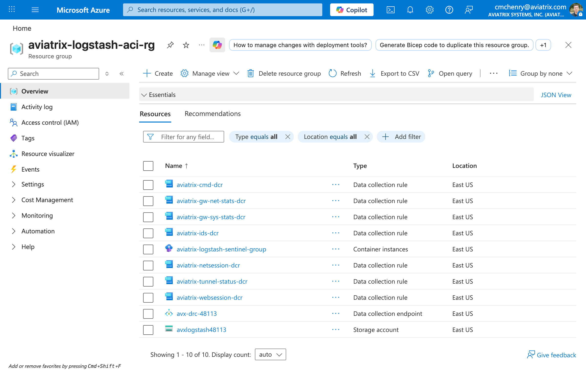
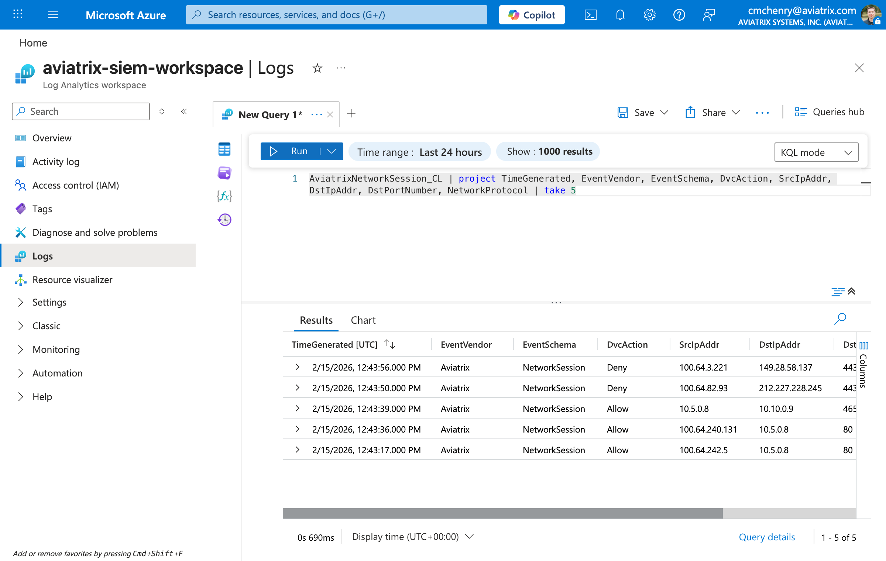

# Azure Container Instances (ACI) Logstash Deployment

Terraform deployment for the Aviatrix SIEM Connector on Azure Container Instances. Receives syslog from Aviatrix gateways/controllers and forwards parsed, ASIM-normalized events to Azure Log Analytics via the Microsoft Log Ingestion API.

> For background on connecting Logstash to Microsoft Sentinel using Data Collection Rules, see the [Microsoft Learn article](https://learn.microsoft.com/en-us/azure/sentinel/connect-logstash-data-connection-rules).

## Architecture

```
Aviatrix Gateways/Controllers
         |
         v (syslog TCP or UDP 5000)
  Azure Container Instance (Logstash)
         |
         v (Log Ingestion API)
  Data Collection Rules (8 DCRs)
         |
         v
  Azure Log Analytics (8 custom tables)
         |
         v
  Microsoft Sentinel (ASIM parsers)
```

> **ACI protocol limitation**: Azure Container Instances can expose only one protocol (TCP or UDP) per port. This deployment defaults to **TCP**, which is recommended for syslog reliability. Set `container_protocol = "UDP"` in tfvars if your gateways use UDP. You cannot expose both TCP and UDP on port 5000 simultaneously.

### Network Exposure (read before production use)

The container group uses a **public IP** (`ip_address_type = "Public"`) and the
syslog port is **unauthenticated**. ACI public IPs cannot have a Network Security
Group, so there is no source-IP filtering: anyone who can reach the FQDN/IP can
send forged Aviatrix log lines, which land in Sentinel as normalized security
events (poisoning analytics rules and adding ingestion cost). The DNS label has a
random suffix, but the IP can still be scanned.

Options, from least to most change:

1. **Accept for lab/demo use only**, and destroy the deployment when done.
2. **VNet-injected ACI (private IP)**: deploy the container group into a delegated
   subnet (`ip_address_type = "Private"` with `subnet_ids`, no `dns_name_label`) and
   attach an NSG to that subnet that allows TCP/UDP 5000 only from the Aviatrix
   gateway and controller egress IPs. Gateways reach it over peering/VPN/ExpressRoute,
   or through an Azure Load Balancer / Firewall DNAT you control. This module does
   not implement the private mode today; it requires a VNet, a subnet delegated to
   `Microsoft.ContainerInstance/containerGroups`, and changing the container group
   (which recreates it).
3. **TLS/mTLS in front of Logstash**: the AWS deployments ship a stunnel TLS sidecar
   (`tls-sidecar/`) that only accepts clients with a trusted certificate. A similar
   sidecar container can be added to the ACI container group, but is not wired up here.

## What Terraform Creates

| # | Resource | Description |
|---|----------|-------------|
| 1 | Resource Group | Container and all child resources |
| 2 | Storage Account + 2 File Shares | Pipeline config (`logstash.conf`) and patterns (`avx.conf`) |
| 3 | Container Group | Logstash container with file share mounts |
| 4 | Data Collection Endpoint | Log Ingestion API endpoint |
| 5 | 8 Custom Tables | ASIM-normalized + operational tables in Log Analytics |
| 6 | 8 Data Collection Rules | One per table, pass-through KQL transform |
| 7 | Service Principal (optional) | Created only when `use_existing_spn = false` |
| 8 | 8 Role Assignments | SPN "Monitoring Metrics Publisher" on each DCR |



### Tables Created

| Table | Log Type | ASIM Schema |
|-------|----------|-------------|
| `AviatrixNetworkSession_CL` | L4 Microsegmentation | NetworkSession (v0.2.7) |
| `AviatrixWebSession_CL` | L7 MITM/TLS Inspection | WebSession (v0.2.7) |
| `AviatrixIDS_CL` | Suricata IDS | NetworkSession, EventType=IDS |
| `AviatrixGwNetStats_CL` | Gateway Network Stats | (none) |
| `AviatrixGwSysStats_CL` | Gateway System Stats | (none) |
| `AviatrixCmd_CL` | Controller CMD/API | (none) |
| `AviatrixTunnelStatus_CL` | Tunnel Status Changes | (none) |
| `AviatrixVPNSession_CL` | VPN Connect/Disconnect | (none) |

> **Note**: FQDN firewall events are parsed by Logstash but do not have an Azure output. Only 8 of the 9 log types are forwarded to Log Analytics.

## Prerequisites

1. **Azure CLI** installed and authenticated
   - Public: `az cloud set --name AzureCloud && az login`
   - China: `az cloud set --name AzureChinaCloud && az login`

2. **Terraform** >= 1.0

3. **Log Analytics Workspace** — must already exist. Provide its name and resource group via variables. If it's in a different subscription, set `log_analytics_subscription_id`.

4. **Container Image** with the Microsoft Sentinel Logstash output plugin installed. See [Container Image](#container-image) below.

5. **Entra ID Service Principal** (one of):
   - **Pre-created** (default, `use_existing_spn = true`): provide `client_app_id`, `client_app_secret`, `tenant_id` in tfvars
   - **Auto-created** (`use_existing_spn = false`): requires "Application Administrator" or "Cloud Application Administrator" Entra ID role

6. **Assembled Logstash config**:
   ```bash
   cd logstash-configs
   ./scripts/assemble-config.sh azure-log-ingestion
   ```

## Container Image

The Logstash container requires the [Microsoft Sentinel output plugin](https://github.com/Azure/Azure-Sentinel/tree/master/DataConnectors/microsoft-sentinel-log-analytics-logstash-output-plugin) pre-installed. The stock Elastic image does not include it.

> In the future, Aviatrix plans to publish an official container image on GitHub Container Registry (ghcr.io). Until then, build your own using the instructions below.

### Building the Container Image

A Dockerfile and build script are provided in [`logstash-container-build/`](logstash-container-build/):

```dockerfile
FROM docker.elastic.co/logstash/logstash:8.16.2
RUN logstash-plugin install microsoft-sentinel-log-analytics-logstash-output-plugin
```

**Option A: Interactive build script**
```bash
cd deployments/azure-aci/logstash-container-build
./build-and-push.sh
```
This creates the ACR (if needed), builds the image, and pushes it.

**Option B: Manual steps**
```bash
# Set variables
export ACR_NAME="yourregistryname"
export RESOURCE_GROUP="your-acr-rg"
export IMAGE="aviatrix-logstash-sentinel:latest"

# Create ACR (if needed)
az group create --name $RESOURCE_GROUP --location eastus
az acr create --resource-group $RESOURCE_GROUP --name $ACR_NAME --sku Standard
# Build and push (pin the plugin version for reproducible builds)
az acr login --name $ACR_NAME
az acr build --registry $ACR_NAME --image $IMAGE \
  --build-arg SENTINEL_PLUGIN_VERSION=<x.y.z> \
  --file deployments/azure-aci/logstash-container-build/Dockerfile \
  deployments/azure-aci/logstash-container-build/

# Pull-only credentials for ACI (instead of enabling anonymous pull, which makes
# every repository in the registry public)
az acr token create --name aci-pull --registry $ACR_NAME --scope-map _repositories_pull
```

After building, set `container_image` and the pull credentials in your `terraform.tfvars`:
```hcl
container_image             = "yourregistryname.azurecr.io/aviatrix-logstash-sentinel:latest"
container_registry_server   = "yourregistryname.azurecr.io"
container_registry_username = "aci-pull"
container_registry_password = "<token password>"
```

See [`logstash-container-build/README.md`](logstash-container-build/README.md) for Azure China instructions.

## Deployment

### Azure Public or China

| Cloud | Folder |
|-------|--------|
| Public | `deploy-public/` |
| China | `deploy-china/` |

### Steps

```bash
# 1. Assemble the Logstash config
cd logstash-configs
./scripts/assemble-config.sh azure-log-ingestion

# 2. Deploy
cd deployments/azure-aci/deploy-public  # or deploy-china
cp terraform.tfvars.sample terraform.tfvars
# Edit terraform.tfvars with your values

# 3. Validate, plan, apply
../scripts/validate-deployment.sh
terraform init
terraform plan
terraform apply
```

### Key Variables

| Variable | Description |
|----------|-------------|
| `container_image` | Full image path (e.g., `yourregistry.azurecr.io/aviatrix-logstash-sentinel:latest`) |
| `container_protocol` | `TCP` (default, recommended) or `UDP` — must match Aviatrix syslog config |
| `log_analytics_workspace_name` | Existing Log Analytics workspace name |
| `log_analytics_resource_group_name` | Resource group of the workspace |
| `log_analytics_subscription_id` | Workspace subscription (if different from deployment) |
| `use_existing_spn` | `true` to provide existing SPN credentials, `false` to auto-create |
| `client_app_id` / `client_app_secret` / `tenant_id` | SPN credentials (when `use_existing_spn = true`) |
| `container_registry_server` / `_username` / `_password` | Optional private-registry pull credentials (use instead of ACR anonymous pull) |
| `spn_secret_rotation_days` | Auto-created SPN only: rotate the secret after N days (default 180) on the next `terraform apply` |
| `azure_cloud` | deploy-public: `AzureCloud` (default) or `AzureUSGovernment` (also switches the Terraform providers to US Gov). deploy-china: `AzureChinaCloud` only |
| `file_share_quota_gb` | Quota of the two config file shares (default 5) |

> `container_image` has no default and must be your custom image; the stock `docker.elastic.co/logstash/*` image is rejected at plan time because it lacks the Sentinel plugin.
>
> With `use_existing_spn = true` (default), `client_app_id`, `client_app_secret` and `tenant_id` must all be set (GUIDs for the IDs); plan fails otherwise. The secret is passed to ACI as a **secure** environment variable, so it is not shown by `az container show` or the portal.
>
> With `use_existing_spn = false`, the generated SPN secret expires `spn_secret_rotation_days + 30` days after it was created. Run `terraform apply` at least once inside that 30-day window after each rotation date (for example from a scheduled pipeline); the apply mints a new secret and recreates the container with it.

> Stream names (`azure_stream_*`) and DCR IDs (`azure_dcr_*_id`) are injected automatically by the module. Do not set them in `terraform.tfvars` or `environment_variables`.

### Post-Deployment Checklist

After `terraform apply` completes, verify:

- [ ] Resource group exists with all child resources
- [ ] Container group is running (`az container show --resource-group <your-rg> --name <container>-group --query provisioningState`)
- [ ] 8 custom tables visible in Log Analytics workspace
- [ ] 8 DCRs created in the resource group
- [ ] SPN has "Monitoring Metrics Publisher" role on each DCR
- [ ] Container logs show Logstash startup (`az container logs --resource-group <your-rg> --name <container>-group | tail -20`)

## Aviatrix Log Export Configuration

Configure Aviatrix Copilot to export logs to the deployed container:

1. Log in to Aviatrix Copilot
2. Go to **Settings > Configuration > Logging services > Edit Profile** under Remote Syslog
3. Configure:
   - **Server**: Use the `container_group_fqdn` output from Terraform
   - **Port**: `5000`
   - **Protocol**: Match `container_protocol` (TCP or UDP)
4. Save

See the [Aviatrix Copilot logging documentation](https://docs.aviatrix.com/documentation/latest/platform-administration/copilot/aviatrix-logging-copilot.html#syslog-profiles) for details.

## ASIM Parser Deployment (Optional)

Three KQL ASIM parser files are provided for Sentinel integration in [`logstash-configs/outputs/azure-log-ingestion/asim-parsers/`](../../logstash-configs/outputs/azure-log-ingestion/asim-parsers/):

| Parser | Schema | Table |
|--------|--------|-------|
| `vimNetworkSessionAviatrixGateway.kql` | NetworkSession | `AviatrixNetworkSession_CL` |
| `vimWebSessionAviatrixGateway.kql` | WebSession | `AviatrixWebSession_CL` |
| `vimNetworkSessionAviatrixSuricata.kql` | NetworkSession (IDS) | `AviatrixIDS_CL` |

Deploy each parser as a saved function in your Log Analytics workspace. See the deployment instructions at the top of each `.kql` file. You can then query them directly, e.g. `vimNetworkSessionAviatrixGateway(starttime=ago(1h))`.

#### ASIM integration (`_Im_NetworkSession` / `_Im_WebSession`)

Saving a function under a custom name does **not** add it to Sentinel's built-in
unifying parsers, so `_Im_NetworkSession | where EventVendor == "Aviatrix"` returns
nothing until the Aviatrix parsers are referenced from the schema's **custom
unifying parser** in your workspace. Follow Microsoft's
[Manage ASIM parsers](https://learn.microsoft.com/azure/sentinel/normalization-manage-parsers)
guide ("Add a custom parser to a built-in unifying parser") and add, for example:

- NetworkSession custom unifying parser: calls to `vimNetworkSessionAviatrixGateway(...)`
  and `vimNetworkSessionAviatrixSuricata(...)`, passing through the filtering
  parameters (`starttime`, `endtime`, `srcipaddr_has_any_prefix`, ..., `disabled`)
- WebSession custom unifying parser: a call to `vimWebSessionAviatrixGateway(...)`

Check the exact custom-parser function names and parameter lists for your
workspace's ASIM version in that guide; if the custom unifying function already
exists, add the Aviatrix calls to its `union` instead of replacing it. After that,
ASIM-based analytics rules and `_Im_*` queries include Aviatrix data.

## Updating Configuration

If you modify filters, patterns, or the output config:

```bash
# Reassemble
cd logstash-configs
./scripts/assemble-config.sh azure-log-ingestion

# Re-deploy (updates the file share, container auto-reloads)
cd deployments/azure-aci/deploy-public
terraform apply
```

The share files track content with `content_md5`, so any edit to the assembled config or `patterns/avx.conf` shows up in the plan as a file replacement. The container has `CONFIG_RELOAD_AUTOMATIC=true`, so Logstash detects the new file and reloads without restart.

If you add a field to `output.conf` that should reach Log Analytics, also add the column to `module/ai/4-table-schemas.tf` (shared by the tables and DCR stream declarations); otherwise the DCR drops it silently.

## Testing Without Live Aviatrix Gateways

Test tools are provided in `test-tools/sample-logs/` to verify the deployment end-to-end without requiring live Aviatrix infrastructure.

### 1. Refresh Test Sample Timestamps

The sample logs have hardcoded timestamps that need to be updated to the current time window (otherwise Log Analytics will reject them or they'll appear as stale data):

```bash
cd test-tools/sample-logs
./generate-current-samples.sh --overwrite
```

### 2. Stream Test Logs

Send the 44 sample log lines (covering all 8 log types) to the deployed container:

```bash
# Get the container FQDN from Terraform output
cd deployments/azure-aci/deploy-public
FQDN=$(terraform output -raw container_group_fqdn)

# Stream all test samples
cd test-tools/sample-logs
./stream-logs.py --target $FQDN --tcp -v --delay 0.5
```

Useful options:
```bash
./stream-logs.py --list-types              # Show available log type filters
./stream-logs.py --filter microseg -v      # Send only microseg logs
./stream-logs.py --loop --delay 1          # Continuous replay
```

### 3. Verify in Log Analytics

Wait 5-10 minutes for ingestion latency, then query each table. Use the workspace ID from your Log Analytics workspace.

```bash
WORKSPACE_ID=$(az monitor log-analytics workspace show \
  --resource-group <your-la-rg> --workspace-name <your-la-workspace> \
  --query customerId -o tsv)

# Check ASIM fields on security tables
az monitor log-analytics query --workspace $WORKSPACE_ID \
  --analytics-query "AviatrixNetworkSession_CL | project TimeGenerated, EventVendor, EventSchema, DvcAction, SrcIpAddr, DstIpAddr | take 5"

az monitor log-analytics query --workspace $WORKSPACE_ID \
  --analytics-query "AviatrixWebSession_CL | project TimeGenerated, EventSchema, DstFqdn, DvcAction | take 5"

az monitor log-analytics query --workspace $WORKSPACE_ID \
  --analytics-query "AviatrixIDS_CL | project TimeGenerated, EventType, ThreatName, ThreatId, EventSeverity | take 5"
```



### Expected Results

From the 48 sample log lines, Logstash produces ~48 output events across 8 tables. FQDN events are parsed but not forwarded to Azure (no Azure output for that log type). One suricata "notice" event is dropped (alerts only).

| Table | Expected Events | Key Fields to Verify |
|-------|-----------------|----------------------|
| `AviatrixNetworkSession_CL` | ~7 | `EventSchema=NetworkSession`, `DvcAction=Allow/Deny` |
| `AviatrixWebSession_CL` | ~12 | `EventSchema=WebSession`, `DstFqdn` populated |
| `AviatrixIDS_CL` | ~1 | `EventType=IDS`, `ThreatName` populated |
| `AviatrixGwNetStats_CL` | ~7 | `total_rx_rate`, `total_tx_rate` fields |
| `AviatrixGwSysStats_CL` | ~7 | `cpu_idle`, `memory_free` fields |
| `AviatrixCmd_CL` | ~4 | `action`, `username` fields |
| `AviatrixTunnelStatus_CL` | ~4 | `src_gw`, `dst_gw`, `new_state` fields |
| `AviatrixVPNSession_CL` | ~6 | `vpn_user`, `vpn_status`, `vpn_gateway` fields |

### 4. Check Container Logs for Errors

```bash
# View recent logs (replace with your actual resource group and container names)
RG=$(terraform output -raw resource_group_name)
CONTAINER=$(terraform output -raw container_group_name)

az container logs --resource-group $RG --name $CONTAINER | tail -20

# Check for successful posts
az container logs --resource-group $RG --name $CONTAINER | grep "Successfully posted"
```

## Clean Up

```bash
terraform destroy
```

This removes all resources created by Terraform. The Log Analytics workspace (a prerequisite, not created by Terraform) is not affected. The ACR and container image (built separately) are also not affected.

## Troubleshooting

### Attach to Container Logs

```bash
RG=$(terraform output -raw resource_group_name)
CONTAINER=$(terraform output -raw container_group_name)
az container attach --resource-group $RG --name $CONTAINER
```

### Query Log Analytics

```kql
AviatrixNetworkSession_CL | take 10
AviatrixWebSession_CL | take 10
AviatrixIDS_CL | take 10
```

### Common Issues

- **Plugin not found**: Ensure you're using the custom container image with the Sentinel plugin, not the stock Elastic image.
- **Image pull fails**: If the registry does not allow anonymous pull, set `container_registry_server`, `container_registry_username` and `container_registry_password`.
- **Config file not updating**: Re-run `./scripts/assemble-config.sh azure-log-ingestion` first; Terraform uploads whatever is in `logstash-configs/assembled/`. Content changes are detected via `content_md5`. To force a re-upload anyway: `terraform apply -replace='module.deployment.azurerm_storage_share_file.logstash_conf'`
- **Fields missing in a table**: The column is not declared in `module/ai/4-table-schemas.tf`, so the DCR drops it. Add it there and `terraform apply` (updates both the table and the DCR).
- **DCR ingestion errors**: Check that the SPN has "Monitoring Metrics Publisher" role on all DCRs. Verify with: `az role assignment list --assignee <spn-object-id> --scope <dcr-id>`
- **No data in tables**: Verify the container is running and receiving syslog. Check `az container logs` for errors. Ensure timestamps in test data are within the last 24 hours (run `generate-current-samples.sh --overwrite` to refresh).
- **FQDN events missing**: This is expected — FQDN events are parsed but not forwarded to Azure. Only 8 of the 9 log types have Azure outputs.
